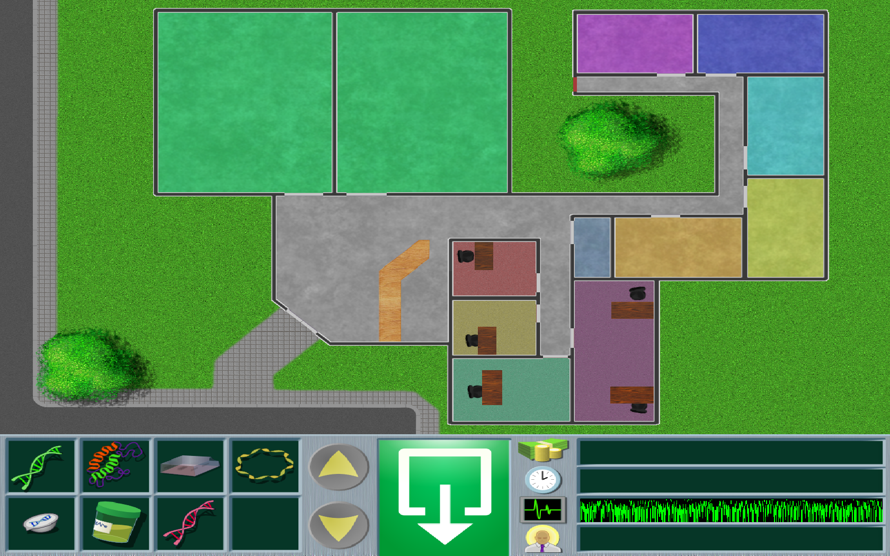

# Dissolved

Dissolved is one of [Richèl Bilderbeek's games](https://richelbilderbeek.github.io/games/).

Questing for cures: an educational game made for the 2014 G2020 e-learning hackathon.

Team:

- Arlette Reneman
- Eveline Broers
- Frode Lindeijer
- Richèl Bilderbeek
- Rob Henning

## Screenshots

## Links

- [Source code](https://github.com/richelbilderbeek/Dissolved)
